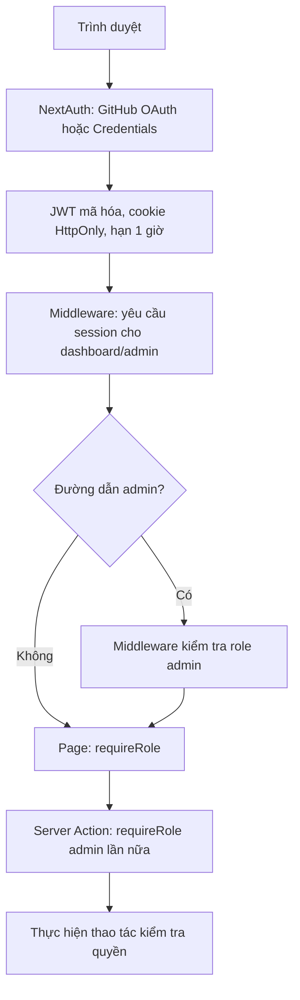

# Buổi 7–8: NextAuth, phân quyền và SEO

Ngày kiểm tra: 22/10/2026. Dự án ban đầu là React + Vite; bổ sung Next.js 15 App Router làm entry mặc định. Bài React cũ vẫn chạy bằng `npm run dev:vite`; `src/pages` chuyển thành `src/views` để Next.js không nhận nhầm là Pages Router.

## Các lớp bảo vệ

| Điểm truy cập | Khách | user | admin |
| --- | --- | --- | --- |
| `/`, `/about`, ảnh Open Graph | Cho phép | Cho phép | Cho phép |
| `/dashboard` | Chuyển đăng nhập | Cho phép | Cho phép |
| `/admin` và đường dẫn con | Chuyển đăng nhập | Chuyển trang từ chối | Cho phép |
| Server Action `runAdminCheck` | Từ chối | Từ chối | Thành công |

- `src/middleware.ts` kiểm tra JWT và vai trò. Các page dùng `requireRole` với `getServerSession`; Server Action kiểm tra lại trước xử lý, kể cả khi UI không được đi qua.
- Credentials so sánh bcrypt với hash trên server. Tài khoản `admin`/`user` được cấp qua biến môi trường; không đọc vai trò từ form. Đây là kho tài khoản phục vụ bài thực hành, chưa có đăng ký hoặc cơ sở dữ liệu người dùng.
- GitHub OAuth luôn cấp vai trò `user`, không cấp admin dựa theo email hoặc dữ liệu client. Callback URL: `/api/auth/callback/github`.
- Session, User và JWT được bổ sung kiểu `id`, `role: 'admin' | 'user'` tại `types/next-auth.d.ts`; không dùng `any` để truy cập role.

## SEO

`/` và `/about` là trang công khai được prerender, có canonical riêng, Open Graph với `opengraph-image.tsx` riêng (PNG 1200 × 630), JSON-LD `WebSite`/`AboutPage`. JSON-LD escape ký tự `<` trước khi nhúng HTML. `SITE_URL` là nguồn URL tuyệt đối và cần đặt đúng trước build production. Các trang tài khoản/đăng nhập/quản trị đặt `noindex`.

## Kiểm chứng

- `npm run build`, `npm run typecheck`, `npm run test:typecheck`, `npm run build:vite`: thành công.
- Jest: **32 test / 4 suite đạt**. Ba test mới gọi thẳng page/Server Action với session giả lập, xác nhận chúng tự từ chối khách và user mà không cần Middleware.
- [Kiểm thử HTTP](testing/next-auth-results.json): đăng nhập sai, user/admin, đường dẫn con, replay action theo vai trò, JWT giả, đăng xuất, canonical/JSON-LD/Open Graph và tải hai PNG.
- [Kiểm thử trình duyệt](testing/next-ui-results.json): form đăng nhập admin, submit Server Action, không lỗi JavaScript, không tràn ngang trên hai trang ở 390 px. [Ảnh trang chủ](validation/next-home-mobile.png), [ảnh giới thiệu](validation/next-about-mobile.png).
- **Chưa kiểm thử đầu cuối GitHub OAuth** vì chưa có Client ID/Secret thật. Cấu hình provider đã được tích hợp; cần hoàn tất thiết lập ứng dụng GitHub và kiểm tra với tài khoản được cấp quyền.

## Lighthouse trước và sau

Đo Lighthouse 12.8.2 trên Chrome headless, mobile, simulated throttling; mỗi URL một lượt trên server production cục bộ, không dùng dev server. Báo cáo này là Lighthouse lab, không phải dữ liệu người dùng thực CrUX/PageSpeed Insights.

| Bản / trang | Performance | Accessibility | Best Practices | SEO |
| --- | ---: | ---: | ---: | ---: |
| Trước: React `/` | 87 | 95 | 100 | 82 |
| Sau: Next.js `/` | 100 | 100 | 100 | 100 |
| Sau: Next.js `/about` | 100 | 100 | 100 | 100 |

Bản trước là trang chủ React từ `dist` có sẵn trước thay đổi, phục vụ bằng Vite preview port 4173. Bản sau là landing page Next.js và trang giới thiệu port 3000. **Nội dung và lượng tương tác trang chủ đã thay đổi**, nên chênh lệch không phải phép thử kiểm soát chỉ riêng SSR/SEO. `/about` là trang mới nên không có điểm trước tương ứng. Các báo cáo `before-1`/`after-1` cũ đo Product Lab và không được dùng làm số liệu cho bài này.

Xem [dữ liệu tổng hợp](lighthouse/next-summary.json), [HTML trước](lighthouse/next-before.report.html), [HTML sau trang chủ](lighthouse/next-after-home.report.html), [HTML sau giới thiệu](lighthouse/next-after-about.report.html). Điểm lab có thể dao động giữa các lượt đo.

## Thiết lập và chạy lại

1. `npm install`, sao chép `.env.example` thành `.env.local`.
2. Tạo `NEXTAUTH_SECRET` bằng `openssl rand -base64 32`; đặt `NEXTAUTH_URL` và `SITE_URL` (mặc định `http://localhost:3000`).
3. Tạo GitHub OAuth App, điền `GITHUB_ID`/`GITHUB_SECRET`; callback local là `http://localhost:3000/api/auth/callback/github`.
4. Điền `ADMIN_EMAIL`, `USER_EMAIL`. Chạy `node scripts/hash-password.mjs` cho từng mật khẩu và chép kết quả vào biến hash tương ứng. Script xuất dấu `$` đã escape cho dotenv của Next.js; không bỏ dấu `\` trước `$`.
5. `npm run build && npm start`. Thử từng vai trò tại `/dashboard` và `/admin`; nút kiểm tra quyền gọi Server Action và hiển thị kết quả thành công.
6. Chạy Jest với `npm test -- --runInBand`. Kiểm thử HTTP dùng hai tài khoản `admin@example.com`, `user@example.com` và mật khẩu truyền qua `AUTH_TEST_ADMIN_PASSWORD`, `AUTH_TEST_USER_PASSWORD` khi chạy `node scripts/verify-auth.mjs`; hash môi trường server phải tương ứng.

Không có tài khoản/mật khẩu mặc định được bật sẵn. Secret và hash thật không đưa vào Git. Khi đổi domain, cập nhật cả `SITE_URL`, `NEXTAUTH_URL` và callback OAuth, sau đó build lại.

Tài liệu triển khai: [NextAuth Middleware](https://next-auth.js.org/configuration/nextjs), [Credentials](https://next-auth.js.org/providers/credentials), [TypeScript](https://next-auth.js.org/getting-started/typescript), [Next.js Metadata và ảnh OG](https://nextjs.org/docs/app/getting-started/metadata-and-og-images).
